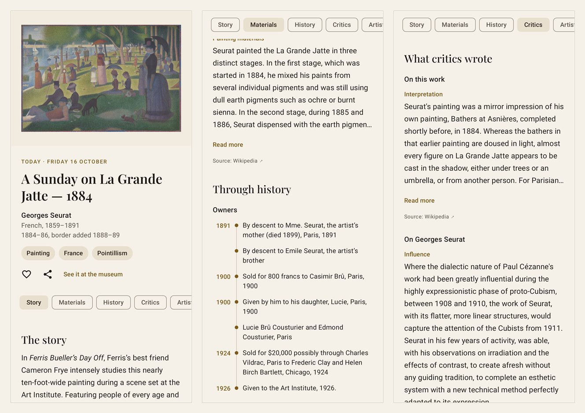
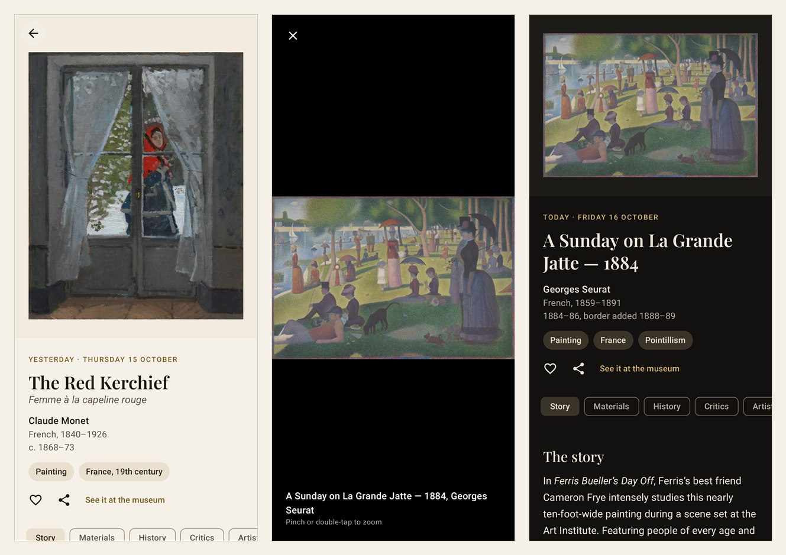

# Daily Gallery

[](https://github.com/Mishallic/daily-gallery/actions/workflows/ci.yml)

An Android app with one artwork a day from two public museum collections: the picture, the
story behind it, its materials and technique, its history (owners, exhibitions), what critics
and scholars wrote about it, and its artist. Earlier days stay in a gallery, and artworks you
save stay on the phone, ready to open offline.





## What it does

- **Today:** the day's artwork, hung on a wall: title, artist (with nationality and dates, or
  the culture for unattributed works), date, and tags (type, place, style). Share it, open it
  at the museum, or save it with the heart. A bar under the label jumps between the sections:
  - **The story:** the museum's own text, Cleveland's "Did you know?", then what Wikipedia says
    (background, description, subject, the work in popular culture).
  - **Materials & technique:** medium, materials, technique, support, dimensions,
    inscriptions, and conservation notes where the museum or Wikipedia has them.
  - **Through history:** the owners from the artist's studio to the museum, and the
    exhibitions it was shown in, on a timeline with years; Wikipedia's history of the work
    (acquisition, provenance, sales).
  - **What critics wrote:** Wikipedia's reception, interpretation and analysis of the work,
    what critics said about the artist, and the books and articles that discuss it, oldest
    first (117 for La Grande Jatte, starting with Jules Christophe's 1890 study of Seurat).
  - **About the artist**, and **Sources:** where the work is on view, its credit line and
    object number, and every source with its licence.
- **Gallery:** every day before today, newest first, as far back as the schedule goes without
  repeating. Each opens its own page.
- **Saved:** the artworks you saved, newest first, kept on the phone for offline reading.
- **Viewer:** tap the picture for it alone on black. Pinch or double-tap to zoom (up to 5x,
  in where you tapped); the sharper copy loads over the one on screen.

Everything shown is the museums' or Wikipedia's own text, and each passage names its source.
The app writes none of it.

## How it works

### The day's artwork

The schedule ships with the app: `app/src/main/assets/pool.json`, 472 artworks built by
[`scripts/build_pool.py`](scripts/build_pool.py) from

- the Art Institute of Chicago's 226 best-known public-domain works with a description (its
  "boosted" set), and
- the Cleveland Museum of Art's 246 CC0 highlights,

each linked through Wikidata to its English Wikipedia article (43 have one) and its artist's
(211). Day N after 16 October 2026 shows entry N, by the phone's local date, so every phone
shows the same artwork on the same day without a server; after the last entry the schedule
starts again. The order alternates the museums and keeps an artist at least two weeks apart.
A rebuild only appends, so a day that has been shown never changes.

### A day's page

`ArtworkRepository` reads the museum's record (and, for the Art Institute, the artist's) and
the Wikipedia articles on the work and the artist, side by side:

| Source | Gives |
| --- | --- |
| Museum record | title, artist, dates, image and its alt text, facts, the museum's text, owners, exhibitions, publications, the artist's biography |
| Wikipedia, the work | its sections, sorted by their headings into story, materials, history and critics; references and links are skipped |
| Wikipedia, the artist | what critics said (Legacy, Influence, Reception...), and the opening as a biography when the museum has none |

The museum is required; Wikipedia is not. When Wikipedia can't be reached the page shows
without it, says what is missing, and reads it again on the next visit. A finished artwork is
cached as JSON on the phone: it opens instantly and offline from then on. The cache keeps the 60
most recently opened artworks and every saved one. The label comes from the schedule, so it
shows at once even when nothing else can.

Some details the sources needed:

- Museum text is HTML (or plain text) with the titles of works in italics; it becomes
  paragraphs with the italics kept.
- The Art Institute's owners come as one sentence; they are split at semicolons outside
  brackets, and an owner's year is the last one outside brackets ("the artist's mother (died
  1899), Paris, 1891" is 1891).
- The Art Institute tags works with Getty vocabulary terms that repeat each other ("oil paint
  (paint)", "paint", "painting techniques"); only the specific ones are kept.
- Cleveland says when a work is only attributed ("Attributed to · Greek, Athenian"), and some
  of its "biographies" are only the artist's dates; those are not shown as one.

## Architecture

```
app/src/main/java/com/dailygallery/app/
  domain/   Pool (the schedule), Artwork, Text (museum HTML to paragraphs, years)   plain Kotlin
  data/     AicSource, ClevelandSource, WikipediaSource: one API each, mapped to an Artwork
            ArtworkRepository (puts a day together), ArtworkCache, SavedStore, OkHttpGet
  ui/       today/ (today, any day), artwork/ (the page and its sections), gallery/ (gallery,
            saved), viewer/ (zoom), theme/, AppNavigation (tabs and routes)
scripts/    build_pool.py (the schedule), dev.ps1 (emulator, tests, screen previews)
```

Kotlin and Jetpack Compose (Material 3), on the same toolchain as Job Watch (AGP 8.7, Kotlin
2.0, Gradle 8.10, JDK 17). OkHttp and kotlinx.serialization read the APIs, Coil 3 loads the
images, Navigation Compose joins the screens. Titles are set in
[Playfair Display](https://github.com/clauseggers/Playfair-Display) (SIL Open Font License,
[`licenses/OFL-PlayfairDisplay.txt`](licenses/OFL-PlayfairDisplay.txt)); running text in the
system sans.

## Tests

```powershell
.\gradlew testDebugUnitTest
```

72 tests, on the PC, with no device and no network:

- **Sources:** each API's saved responses (La Grande Jatte and Seurat from the Art Institute;
  The Red Kerchief, the Cleveland Apollo and a Chola bronze from Cleveland; three Wikipedia
  articles) mapped to an artwork, field by field.
- **Repository:** a day put together; read once and then from the cache; shown without
  Wikipedia and completed on the next visit; offline with and without a cached copy.
- **Schedule:** the day arithmetic, and the shipped pool (no repeats, both museums, https
  thumbnails, artists two weeks apart).
- **Text, zoom, HTTP client, saved list, cache pruning.**
- **Screens (Robolectric):** today's page and every section, offline, without Wikipedia, the
  dark theme, the viewer, the gallery, a past day, saving and unsaving, and the app starting.
  They run on saved responses and the real images, and draw each screen to
  `app/build/screenshots`.

A live check reads the first 30 days of the schedule from the real museums and Wikipedia and
fetches every image. It is off by default; run it after rebuilding the pool:

```powershell
$env:DAILY_GALLERY_LIVE = "1"; .\gradlew testDebugUnitTest --tests "*LiveSourcesTest" --rerun
```

**CI** (GitHub Actions) runs lint, the tests and the build on every push, and keeps the drawn
screens as an artifact.

## Limits

- **Wikipedia covers few of the works:** 43 of the 472 have their own article. For the rest,
  "What critics wrote" is what critics said about the artist (211 have an article) and the
  museum's list of publications, which gives titles and dates, not what they say.
- **The schedule repeats** after 472 days, and days before 16 October 2026 count back from
  its end, so the gallery is full from the first day.
- **A connection is needed the first time** a day is opened; after that it reads offline.
  Images are cached separately (up to 100 MB) and can be evicted before the text.
- **The Art Institute's image server** is behind a Cloudflare check that answers 403 to most
  agents but lets OkHttp's through, so the app's agent ends with `okhttp/4.12.0`. If that rule
  changes, its images stop loading (the live check would show it).
- **English only**, and the day changes at the phone's local midnight.

## What is deliberately left out

- **No user ratings or reviews:** "reviews" here are what critics and scholars wrote. Shared
  reviews would need accounts, a server and moderation.
- **No server:** the schedule ships with the app and every phone works out the day itself;
  the sources are read directly.
- **No database:** a cached artwork is one JSON file and the saved list another.
- **No notification or home-screen widget** yet (see [TODO.md](TODO.md)).

## Data and licences

- [Art Institute of Chicago API](https://api.artic.edu/docs/): data and images of
  public-domain works CC0; descriptions [CC BY 4.0](https://creativecommons.org/licenses/by/4.0/).
- [Cleveland Museum of Art Open Access](https://openaccess-api.clevelandart.org/): data and
  images CC0.
- [Wikipedia](https://en.wikipedia.org), read through the MediaWiki API: text
  [CC BY-SA 4.0](https://creativecommons.org/licenses/by-sa/4.0/). Links between the works,
  the artists and their articles come from [Wikidata](https://www.wikidata.org) (CC0).

Every request names the app in its user agent, as these services ask.

## Run locally

Requires JDK 17 and the Android SDK with platform 35. `local.properties` (git-ignored) must
point at the SDK: `sdk.dir=C\:\\path\\to\\Android\\Sdk`.

```powershell
.\gradlew lintDebug
.\gradlew assembleDebug       # app/build/outputs/apk/debug/app-debug.apk
```

### In VS Code, with the emulator

[`scripts/dev.ps1`](scripts/dev.ps1) drives an Android emulator, and the VS Code tasks in
[`.vscode/tasks.json`](.vscode/tasks.json) call it (**Terminal > Run Task**):

| Task | Does |
| --- | --- |
| **Set up emulator** | Once: downloads the emulator and an Android 15 image to `D:\android\sdk` and creates a Pixel 7 device in `D:\android\avd` (about 5 GB). |
| **Run on emulator** (Ctrl+Shift+B) | Builds, installs and opens the app; starts the emulator first if needed. |
| **Start emulator** | Boots the emulator. |
| **Tests** | Unit and Robolectric UI tests on the PC. |
| **Screen previews** | Draws every screen to a PNG in `app/build/screenshots`, on the PC with no emulator; open them in VS Code. |
| **Emulator screenshot** | Saves the emulator's screen to `build/emulator.png`. |

The emulator opens in its own window next to VS Code. It needs hardware acceleration; on
Windows, turn it on once, from PowerShell as Administrator, then restart:

```powershell
Enable-WindowsOptionalFeature -Online -FeatureName HypervisorPlatform -All
```

Paths default to this PC's: set `JAVA_HOME`, `EMULATOR_SDK_ROOT` or `ANDROID_AVD_HOME` to
override them. The build SDK and `adb` come from `local.properties`.

### Rebuild the schedule

```powershell
py -3 scripts/build_pool.py   # standard library only; appends new artworks to pool.json
```

## Release

```powershell
.\gradlew assembleRelease     # app/build/outputs/apk/release/app-release.apk
```

Release builds are signed with the building machine's debug key, like Job Watch, so an update
installs over an earlier version only when both were built on the same machine. Install by
opening the APK on the phone and allowing installs from that source.
